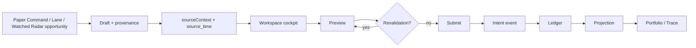

# Paper Decision Lifecycle

**Status:** Authoritative end-to-end architecture.  
**Supersedes** scattered descriptions in completion records for *current* behavior — those records remain historical evidence.

> Current architecture: this document. Historical delivery detail: completion records linked below.

## Flow

OCT1-06 adds explicit Screener ActionDecision assessment before a draft. ENTER
and EXIT can prepare the existing Workspace preview/close flow, with bounded
action/snapshot refs. Both preview and submit revalidate those refs; governed
entry additionally reuses BUILD 22 PreTradeRiskEngine and the existing Paper
risk path. A reduced approved quantity requires a new preview. No state triggers
submission. See [Screener action decisions](SCREENER_ACTION_DECISION.md).



The canonical Paper runtime also supports the governed broker-paper branch:

```text
Preview (dry-run)
  -> prepared Paper intent/risk decision
  -> append intent/order admission
  -> composed paper_execution provider
  -> cumulative status poll / cancellation
  -> recorded reconciliation report
  -> read-only broker and ledger projections
```

`BROKER_PAPER` remains Paper-only authority. A broker provider is bound into
the session when it opens; an absent or disabled provider rejects the session
or operation before network/provider mutation. Polling applies cumulative
fills by `broker_fill_id`, so restart and replay do not duplicate earlier
executions. A partially filled order may complete as `FILLED` or be cancelled
as `CANCELLED`; options and prediction-outcome settlement are unchanged.

RT-01 traces are diagnostic spans over these existing seams. Their latency
clock is process monotonic time, while provider event/receive/available times
remain distinct. Each trace is linked by `trace_id` and `correlation_id` and
references bounded persisted IDs only; the append-only Paper ledger and
business execution trace remain authoritative.

## Backend-only strategy Paper lineage

The deterministic strategy Paper loop is a backend orchestration path. It
does not add a UI route, replace the workspace submit boundary, or create a
second execution or allocation authority:

```text
StrategyDefinition
  -> StrategyMatch (MATCHED)
  -> ForecastV1 + prediction-ledger registration
  -> canonical OpportunityV1 + universal economic assessment
  -> clustering -> comparison -> capital allocation
  -> persisted allocation decision set
  -> TradeProposalV1 -> RiskDecisionV1
  -> Paper order/fill events -> portfolio accounting
  -> cumulative strategy attribution from actual fills
```

The canonical internal strategy Paper path now persists an immutable
`OrderReadyV1` record between `RiskDecisionV1` and Paper submission. Its
decision-thread `correlation_id` is carried from the strategy match through
allocation, proposal, risk, order, and fill records. Durable `OrderReadyV1`
records must also retain an `opportunity` entry in `lineage_refs` so the
execution-preparation boundary can explain the opportunity without inventing
authority; `opportunity_id_from_order_ready` / `order_ready_correlation_snapshot`
are read-only extractors for that contract. A read-only unified business
trace reconstructs these records by `allocation_decision_id` through
`GET /paper/trace?allocation_decision_id=...`; the existing intent/order/fill
anchors remain supported for manual Paper orders.

### Canonical opportunity construction (P1-2)

Authoritative `OpportunityV1` / `OpportunityAssessmentV1` records are minted
only by:

```text
StrategyMatch (MATCHED)
  -> intelligence/opportunity/bridge.py (bridge_strategy_match_to_opportunity)
  -> OpportunityEngine.assess
  -> persist assessment + opportunity (once)
```

`OpportunityEngine.assess` remains the numeric engine and is valid in
fixture/unit tests. Direct engine construction, the P4 adapter, and the
universal economic sidecar are **not** alternate opportunity builders. Two
constructions of the same identity with different lineage conflict on persist
(`IMMUTABLE_CONFLICT`); they must not produce duplicate authoritative records.

Research-only scanners (`UniversalStrategyScanner`) emit matches only and do
not construct `OrderReadyV1`. Execution-intent `StrategyPaperRuntime` must
supply `strategy_eligibility`; omitting it fails closed as ineligible.

### Lane vocabularies (P1-4)

Three naming systems stay distinct. Crosswalk: `lanes/vocabulary.py` (tested)
and UI `EVIDENCE_LANE_TO_MODULE_ID`.

| Vocabulary | Examples | Meaning |
|---|---|---|
| Discovery | `MOMENTUM`, `SQUEEZE`, `CATALYST`, `SWING` | Screener attention buckets |
| Workspace kebab | `squeeze`, `order-flow`, `catalyst`, `order-book` | UI module routes |
| Evidence `LaneId` | `short_squeeze`, `market_context`, `order_flow` | Research-family publishers |

`MARKET_CONTEXT` / `LaneId.market_context` is information / catalyst /
narrative intelligence. It maps to workspace **`catalyst`**, not `order-book`
(L2 book UI) and not `order-flow` (microstructure).

The trace reports portfolio settlement and prediction settlement separately.
Portfolio settlement is the fill-driven `PositionChanged` event that powers
Paper accounting. Prediction settlement remains governed by the prediction
ledger and explicit `settle_due_and_evaluate()` calls. Neither trace
projection nor prediction settlement grants execution authority.

`CapitalAllocationDecisionV1` is an immutable IntelligenceRepository sidecar.
It freezes the account, mode, point-in-time decision, ordered allocator
candidate set, comparison/allocation constraints, rank, reason codes, and
references to the StrategyMatch, ForecastV1, opportunity, economic
assessment, cluster, and portfolio snapshot. `SELECTED`, `NOT_SELECTED`, and
`NO_ALLOCATION` remain distinct; comparator-excluded and scanner-rejected
items are not duplicated as allocation records.

Quantity facts remain separate throughout the path:

- desired allocation quantity/notional is recorded on the allocation decision;
- requested proposal quantity/notional is recorded on the trade proposal;
- approved or reduced risk quantity/notional is recorded on the risk decision;
- submitted quantity is recorded on the Paper order;
- actual filled quantity is recorded only by the Paper fill event.

Strategy attribution is a P&L sidecar, not portfolio-ledger authority. Its
materializer selects persisted Paper orders carrying backend allocation,
proposal, or risk lineage, then creates immutable cumulative snapshots whose
identity covers the exact fill set. The latest complete snapshot is selected
by coverage and time; cumulative snapshots are never summed. Account P&L
continues to come from fill-driven portfolio accounting, and reconciliation
expects the strategy slice to agree with that authoritative result.

Forecast registration and outcome settlement are independent of trade
closure. A closed Paper trade may therefore remain `NOT_DUE` until the
forecast availability cutoff. Due settlement joins the persisted
StrategyMatch, ForecastV1, prediction outcome, and latest complete trading
attribution through the governed learning boundary; any research handoff is
non-promotional and cannot promote a champion or authorize execution.

Reconstruction resolves these persisted references and Paper/portfolio
projections by account and mode. The runtime receipt is ephemeral: no
persisted story object becomes authoritative. Replays with the same
deterministic IDs and content are idempotent, while changed content for an
existing ID is an immutable conflict. Missing, expired, future, mismatched,
or unauthorized inputs stop before downstream Paper mutation.

## Exact spot trade-history projection

Crypto spot fills use the canonical Decimal accounting path rather than the
legacy equity fill projection. `PaperExecutionLedger.project_trades()` replays
those immutable fills through the same canonical accounting function on a fresh
read-only portfolio. Trade rows preserve exact native quantities as decimal
strings and use the instrument's price scale; legacy equity quantities remain
integers. Closed crypto realized P&L remains in the account projection after the
open position disappears and after restart. Integer minor-unit trade deltas use
cumulative conversion so subminor gains are retained in the account total.

This reporting contract does not change order admission, preview authority,
BUILD 22 minimum size, owner limits, or forecast requirements. It is not proof
that the autonomous fractional crypto admission path is complete.

## Stages

### 1. Attention / lane origin

- **Paper Command:** `AttentionItem` from backend projections; optional `surfaced_time` (epoch ns)
- **Workspace lane:** `createLanePaperOrderDraft` with module provenance
- **Handoff:** router state carries placeholder draft + `sourceContext`

### 2. Draft (`paperOrderDraft.ts`)

- Version-1 draft contract with optional `sourceContext`
- `correlation_id` encodes provenance (lane, attention, manual)
- `source_time` set **once** at handoff via `resolvePaperDecisionSourceTime`
- Legacy drafts without `source_time` remain valid

### 3. Workspace cockpit (`PaperDecisionCockpit`)

- Handoff panel, decision snapshot, risk context, preview status
- Order ticket embedded; `showLaneBanner=false` in cockpit
- Observability layer (`WorkspaceObservability`) unchanged below

#### Risk control panel (OCT1-08)

The cockpit shows the [SMA trailing-stop monitor](PAPER_SMA_TRAILING_STOP.md)
for the instrument's Paper position: status, direction in words, policy,
SMA, candidate, active and previous stop, distance, update time and
monitoring liveness. On a breach it shows the server EXIT decision and
`Paper close: NOT SUBMITTED`; `Prepare Paper Exit` is the existing action
handoff and only fills the ticket with the current ledger quantity. Preview and
submit stay in the ticket.

#### Lifecycle view in the Screener (OCT1-10)

After a submit, the AI Screener shows the resulting position as a
[trade lifecycle](SCREENER_TRADE_LIFECYCLE.md): simulated fill, position, mark,
stop, exit and P&L, joined to the decision that authorized the order through the
`ACTION_DECISION` reason on the intent. The view is read-only. Its
`Prepare Paper Exit` is the same handoff as above and still ends in this ticket.

### 4. Preview

- Server validates draft against current state
- States: `NOT_PREVIEWED`, `PREVIEWING`, `ACCEPTED`, `REJECTED`, `REVALIDATION_REQUIRED`, `AUTHORITY_UNAVAILABLE`, `ERROR`
- Accepted upstream preview **cannot** authorize submission if draft changed

### 5. Submit

- Requires current accepted preview (`confirmedRequestIsCurrent`)
- Placeholder handoff drafts also require explicit side/quantity confirmation
  before Submit enables (accidental-submit gate)
- Request includes `decision_source_snapshot` (bounded fields)
- `correlation_id` preserved through intent
- Successful submit surfaces a durable **order acknowledgement** in the cockpit:
  order id, status, provenance (including `opportunity:{id}`), and a link to
  Portfolio Order history (`/portfolio#portfolio-order-history`)
- Acknowledgement never invents fills; fill is shown only when the server
  response already carried one from canonical internal simulation

### 6. Intent → ledger → projection

- `build_user_order_intent` persists snapshot on intent metadata
- Ledger append-only events
- `project_orders()` → Portfolio history, execution trace
- Order-history query invalidates on submit so the new durable order is
  readable immediately after navigation to Portfolio

## Paper short selling

Rebuild step 6 (owner decision 2, 2026-10-23; 50% margin chosen 2026-10-25). Paper only, internal simulation
only; Live stays off and the live canary refuses shorts on its own policy.

- **Account term.** `allow_short` is chosen once when an experiment account is created
  (`POST /paper/experiments` body `allow_short`, Portfolio checkbox "Allow short selling") and frozen in its risk
  policy with the short terms (`risk/policy.py` `SHORT_POLICY_DEFAULTS`). An account without shorts carries none of
  these keys, so its policy hash and every id derived from it are unchanged. `PaperExecutionLedger.allows_short()` is
  true only for that term on a portfolio-scoped `INTERNAL_SIMULATION` ledger, never broker paper.
- **Short-sale gate** (`paper/short_gate.py`, at preview and at submit). A sell that only reduces a long passes
  unchanged. A short open must be an admitted security (equity or ETF; never crypto, options or futures), priced at
  or above $5.00, not in a name down 10% or more on the day (`SHORT_SALE_RESTRICTION`), with a known day change
  (`SHORT_SALE_RESTRICTION_UNKNOWN` otherwise; the day change comes from the Action decision's own admitted
  TECHNICALS evidence and is recorded on the intent as `short_sale_facts`), and with 50% initial margin available
  (`INSUFFICIENT_SHORT_MARGIN`). Long-to-short and short-to-long in one order are refused
  (`POSITION_REVERSAL_NOT_ALLOWED`).
- **Buying power.** Short proceeds are credited to cash and held back again with the margin: buying power is cash
  less working-order reservations less 150% of open short value (and of working short sales). Longs stay cash-only.
- **Covers.** A buy against a short, up to its size, is never refused for cash and never cut by the BUILD 22
  exposure, concentration, cash or daily-loss caps. A cover that costs more than the cash leaves negative cash: the
  honest record of that loss.
- **Maintenance.** With complete marks, equity below 30% of open short value is a breach
  (`SHORT_MAINTENANCE_MARGIN_BREACH`): the controller buys back the largest-loss short, one per cycle, and new
  entries are blocked until it clears.
- **Borrow.** Shares are assumed borrowable (`SIMULATED_EASY_TO_BORROW`); there is no locate feed. A short held over
  a session close pays 0.50% a year on its value (actual/360, rounded up), as an append-only
  `ShortBorrowFeeAccrued` ledger event that lowers cash and realized P&L.
- **Close-out.** The end-of-day flatten buys shorts back as well as selling longs.
- **AI.** Prompt `screener.action_decision.v4` states that a SHORT entry needs `context.allow_short` and that EXIT
  on a short covers it. The server gate decides either way.
- **Not changed here.** Legacy single-instrument sessions keep their existing sell rule (it can still sell from
  flat without a short check); the close-out's provider-health and manual-position rules are step 7.

## Key identifiers

| Field | Role |
|-------|------|
| `correlation_id` | End-to-end decision linkage |
| `client_order_id` | Per-order client identifier; manual orders may equal correlation |
| `intent_id` / `order_id` | Backend persistence IDs |
| `trace_id` / `span_id` | Diagnostic causal linkage; never business authority |
| `signal_id` / `opportunity_id` / `risk_decision_id` | Persisted decision references |
| `broker_order_id` / `broker_fill_id` / `report_id` | Broker and reconciliation references |
| `decision_source_snapshot` | Immutable handoff context at submit time |

See [DATA_CONTRACTS.md](DATA_CONTRACTS.md) for timestamp and ID rules.

## Immutability rules

| Data | Mutable? |
|------|----------|
| `sourceContext` on draft after handoff | No — preserve `initialDraft.sourceContext` through preview/submit |
| `source_time` | No — chosen at handoff only |
| `decision_source_snapshot` on intent | No — written at submit |
| Current workspace evidence | Yes — may trigger revalidation |

## Failure behavior

- Authority loss: observe, do not submit
- Schema mismatch on snapshot: fail closed on write; degrade safely on read
- Missing `source_time`: omit display; record still valid
- Unknown provenance: degrade to `UNKNOWN` badge

## Legacy compatibility

- Orders without snapshot or `source_time`
- Manual orders (`correlation_id === client_order_id`)
- Old draft versions without `sourceContext`

## Completion records (historical)

- [Command → Workspace handoff](../superpowers/plans/2026-08-31-paper-command-workspace-handoff-completion.md)
- [Decision cockpit](../superpowers/plans/2026-08-31-paper-workspace-decision-cockpit-completion.md)
- [Portfolio history](../superpowers/plans/2026-08-31-paper-portfolio-decision-history-completion.md)
- [Source snapshot](../superpowers/plans/2026-08-31-paper-decision-source-snapshot-completion.md)
- [Source time](../superpowers/plans/2026-09-01-paper-decision-source-time-completion.md)

## Code map

| Area | Location |
|------|----------|
| Draft / snapshot builders | `ui/src/components/paper/` |
| Cockpit | `ui/src/components/paper-workspace/` |
| Backend intent | `src/market_platform_foundation/paper/` |
| Projections | `ui_api/projections.py`, `paper_projections.py` |
